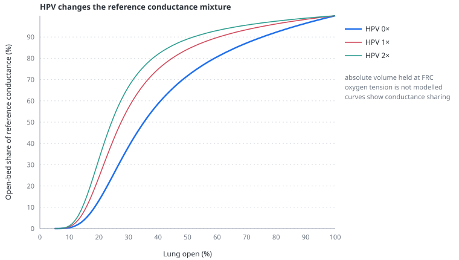

# Hypoxic pulmonary vasoconstriction

> Hypoxic pulmonary vasoconstriction redirects blood away from poorly ventilated lung, but the model represents this as selective tone in derecruited units rather than as an oxygen-driven regional response.

---

## Physiology

Systemic arteries dilate in local hypoxia; small pulmonary arteries do the opposite. A fall in alveolar oxygen tension constricts vessels supplying that region and can divert perfusion toward better ventilated lung. This local response improves ventilation–perfusion matching when hypoxia is patchy.

The same mechanism has a cost. If hypoxia is widespread, vasoconstriction acts across much of the pulmonary circulation and raises right ventricular afterload. Its net effect therefore depends on how much lung is involved, the remaining recruitable vascular bed, pulmonary arterial and venous pressure, cardiac output, mixed venous oxygen tension, carbon dioxide, pH and time.

In a human experiment by Morrell and colleagues, lobar hypoxia during bronchoscopic occlusion reduced regional perfusion over minutes; hyperoxic occlusion did not produce the same response. This supports an oxygen-dependent, time-dependent redistribution mechanism, not an instantaneous rule tied only to lung closure.

HPV is neither an on/off switch nor a direct function of macroscopic lung collapse. Aerated units can be hypoxic, derecruited units can receive little flow, and vascular obstruction can raise PVR without hypoxia. Recruitment may improve oxygenation and restore vascular area, but overdistension can simultaneously compress alveolar vessels.

## In the model

The model calculates a geometric resistance reference from open and derecruited pathways in parallel. Their reference conductances add:

$$
G_{pul} = \frac{\phi}{R_{open}} + \frac{1-\phi}{R_{closed}}
$$

- $G_{pul}$ — total reference conductance, the reciprocal of the geometric resistance coefficient
- $\phi$ — fraction of represented lung currently open, from 0 to 1
- $R_{open}$ — resistance of the open pathway, including alveolar and extra-alveolar vessel components
- $R_{closed}$ — resistance assigned to the derecruited pathway

The HPV control raises $R_{closed}$ only. This reduces the closed pathway’s share of reference conductance and increases the equivalent geometric resistance. In the running three-compartment circuit, the HPV-associated increase is placed before the alveolar-exposed middle store. It therefore adds precapillary load rather than venous obstruction. The model does not calculate separate regional pressures, storage or actual flows for open and closed populations.

The graph holds absolute lung volume at the model’s vascular FRC and varies only the open fraction and HPV setting. At a partially open state, stronger selective tone raises the open pathway’s share of reference conductance. That fraction would also be a flow fraction if both pathways experienced the same driving pressure with no independent storage. The running circulation does not resolve those regional conditions, so the graph is a conductance construction, not measured regional perfusion or a human dose–response curve.

There is no alveolar or arterial oxygen tension in the model. The control therefore means **the strength of a selective vascular response associated with derecruited lung**, not a calculation of biological HPV from oxygen. Its gain and the baseline closed-path resistance are didactic shape coefficients.

## Why this and not something else

A closed-pathway gain lets the influence of HPV depend on how much lung is closed. It illustrates selective resistance and its effect on the aggregate load with one control. The reference conductance shares explain the physiological tendency to divert perfusion, while the pressure-bearing circuit computes the resulting global haemodynamic response.

There is no mechanistic oxygen-sensing response. Regional ventilation, perfusion, shunt, oxygen content, mixed venous oxygen, acid–base state and vascular response kinetics are outside the model. HPV is an aggregate gain on the closed pathway, so its setting does not predict a response to a measured oxygen tension.

## Limits

### Of the construction

- Derecruitment is used as the trigger surrogate; alveolar oxygen tension is not computed.
- Open and closed pathways contribute to a reference conductance mixture. They do not have separately integrated regional pressures, blood volumes or flows, and there is no gravitational distribution.
- The model has no gas exchange, shunt fraction, dead space, mixed venous oxygen, hypercapnia, acidosis, endothelial mediators or time-dependent HPV response.
- The vasoconstrictor response changes resistance but does not alter vascular compliance or pulsatile impedance.
- HPV and the open fraction are user-visible model states, not quantities measured directly at the bedside.

### Of clinical application

- Changing the HPV slider cannot predict oxygenation, pulmonary artery pressure or response to inhaled pulmonary vasodilators in a patient.
- A high derived PVR does not identify HPV as its cause; obstruction, low flow, pressure-dependent vessel calibre and elevated downstream pressure remain alternatives.
- The robust teaching claim is qualitative: selective constriction can improve perfusion matching locally while increasing global RV load when it involves a large vascular territory.

## Validation

Executable checks require stronger HPV to reduce the derecruited pathway’s reference-conductance share, stronger collapse to reduce reference conductance, and the geometric coefficient to remain the parallel combination of open and closed beds. The resistance partition assigns the HPV-associated increment upstream of the middle store. These are internal mechanism checks, not validation against measured regional human perfusion.

## References

- Morrell NW, Nijran KS, Biggs T, Seed WA. Magnitude and time course of acute hypoxic pulmonary vasoconstriction in man. *Respir Physiol*. 1995;100:271–281. [doi:10.1016/0034-5687(95)00002-U](https://doi.org/10.1016/0034-5687(95)00002-U) — eight normal subjects, induced lobar hypoxia and serial scintigraphic perfusion measurements; supports direction and time dependence, not the model gain.

- Sylvester JT, Shimoda LA, Aaronson PI, Ward JPT. Hypoxic pulmonary vasoconstriction. *Physiol Rev*. 2012;92:367–520. [doi:10.1152/physrev.00041.2010](https://doi.org/10.1152/physrev.00041.2010)
- Dunham-Snary KJ, Wu D, Sykes EA, et al. Hypoxic pulmonary vasoconstriction: from molecular mechanisms to medicine. *Chest*. 2017;151:181–192. [doi:10.1016/j.chest.2016.09.001](https://doi.org/10.1016/j.chest.2016.09.001)
- Marshall BE, Marshall C, Frasch F, Hanson CW. Role of hypoxic pulmonary vasoconstriction in pulmonary gas exchange and blood flow distribution. *Intensive Care Med*. 1994;20:291–297. [doi:10.1007/BF01708967](https://doi.org/10.1007/BF01708967)

---

## See also

[Pulmonary vascular resistance](pulmonary-vascular-resistance.md) · [The two-population lung](two-population-lung.md) · [Lung opening profiles](recruitment-and-ri.md) · [The right ventricle](the-right-ventricle.md) · [Global limits](global-limits.md)
