# The Guyton diagram

> The default view updates venous return and a local RV-function curve continuously, with low computational cost. An optional Deep CO experiment measures whole-heart output at the LV outlet. Both use atmospheric right atrial pressure on the horizontal axis.

---

## Physiology

Blood must be able to return to the heart and pass through the right ventricle, lungs and left ventricle. At whole-circuit steady state, mean venous return, RV output and LV output are equal. The descending venous-return relation and ascending cardiac-output relation therefore share a steady operating point.

The default ascending relation is labelled **RV function**. It estimates RV output from right atrial filling, RV diastolic mechanics, contractility and pulmonary arterial load. It is a local analytic approximation, not an independently calculated LV-response curve. The formula is updated from the displayed circulation on every redraw; it does not wait for a new loading experiment to settle.

In the optional deep mode, the ascending relation is labelled **Cardiac output (LV)**. This means aortic output from a heart containing both ventricles. It does not mean that right atrial pressure is being substituted for left atrial pressure in a single-LV filling equation. A weak LV can raise pulmonary and right-heart filling pressures and limit whole-heart flow; a pressure-loaded RV can likewise limit the blood reaching the LV.

Reduced venous inflow can relieve excessive distension. That may be useful even without a rise in flow, but does not itself prove that a cardiac-function curve has improved. A better response means more flow at comparable filling pressure, or lower filling pressure for comparable flow, under specified loading conditions. Right atrial pressure here is relative to atmosphere: it can rise when external cardiac pressure rises even while transmural filling pressure falls.

## Choose the view for the question

| question | view | what it can answer |
|---|---|---|
| How does breathing move the conditions for venous return and RV filling? | **Live** | shows respiratory movement of two local relations |
| Where do these conditions sit on average after redistribution? | **Mean** | compares respiratory-smoothed relations and measured inflow |
| How much whole-heart flow can this separately conditioned circulation sustain at several imposed inflows? | **Deep CO** | runs a separate loading experiment, with a substantial computational cost |

## Reading the points and curves

**Mean is the opening view.** Use it to compare two settings after allowing blood to redistribute. Select **Live** to follow what happens during a single breath. Both choices stay visible and the selected one is highlighted. Both update as the simulation runs.

The horizontal axis shows **right atrial pressure relative to atmosphere** in mmHg. Positive-pressure inflation can raise pressure around the heart. The pressure inside the atrium can then rise even as the pressure distending its wall falls. The vertical axis shows flow in L/min.

- The blue **Venous return** curve gives the forward flow supported at each atrial pressure by the systemic filling pressure, caval closing pressure and resistance to return.
- The red **RV function** curve estimates what the right ventricle can eject at each atrial pressure under the current loading conditions. Its shape uses RV filling, contractility and pulmonary arterial load. It is anchored to atrial pressure and RV end-diastolic and end-systolic volumes. Its highlighted segment identifies the steep part of the local preload-reserve construction.
- The **filled dot** shows net venous inflow from the inferior vena cava into the right atrium. Its height counts forward volume minus backward volume per unit time. Its position uses atrial pressure averaged over the same interval as the flow.
- The **cross** marks the pressure and flow at which the two drawn relations agree. The dot and cross retain their own coordinates when they overlap. The legend gives flow and atrial pressure for each visible point. A missing crossing in the supported range is identified in the legend.
- The faint **inflow path** connects successive one-heartbeat means of measured pressure and inflow. The shape shows how they change together as the patient breathes.

**In Mean**, the dot uses a moving respiratory-duration window after heartbeat smoothing. The curves use determinants averaged over the same window. The cross identifies their intersection. During the first breath after a change, that window can still contain samples from the preceding setting. Averaging does not establish that blood has finished redistributing. At steady state the mean flows through the cava, pulmonary valve and aortic valve should agree. The agreement between measured inflow and the local curve crossing is approximate. For example, the descending curve represents forward flow while the cava can briefly carry blood back from the atrium. [Venous return](venous-return.md) describes that difference.

**In Live**, the filled dot follows the head of the inflow path. Its coordinates and the determinants of both curves use a sliding window one heartbeat long. This suppresses much of the cardiac pulsation while retaining respiratory movement. RV chamber volumes entering the red curve come from completed beats. Hover over the plot to see the **crossing in this phase**. Choose **Inspect crossing** by click, tap or keyboard to keep it visible. Select the button again to release it.

Within one heartbeat the volume entering the right atrium may exceed the volume the RV ejects through the pulmonary valve. For example, if 70 mL enters from the cava and 65 mL leaves through the pulmonary valve in the same beat, the right atrium and ventricle together gain 5 mL. The dot follows measured caval inflow in this beat. The cross identifies where the venous-return and RV ejection estimates give equal flow at the same atrial pressure. If ejection exceeds inflow, these chambers release blood. The distance from the dot to the cross does not measure that volume. Compare actual inflow and ejection over the same time interval to calculate storage. In pulmonary embolism or severe RV pressure loading, the trail can be broad while the respiratory-mean points remain close. Drawing a trail from successive predicted crossings would hide this measured variation.

No deep-response worker or loading experiment starts in Mean or Live. Open **?** to read numerical pressure and flow values on both time scales.

## Healthy passive volume control: PEEP 5 to 15

The [guided reading](quick-start.md#why-can-cvp-rise-while-venous-return-falls) walks through the three monitor readings with a Pin. Select **Healthy, passive volume control**, then change only PEEP from 5 to 15 cmH2O. Tidal volume remains 450 mL, respiratory rate 14/min, heart rate 75/min and autonomic feedback off. Distinguish the immediate respiratory/transient movement from the position reached after redistribution. Mean makes the latter easier to compare; Live shows the excursion around each state.

The same tidal volume can occur around a higher end-expiratory lung volume. In this preset, greater lung inflation increases pleural and abdominal pressures through the represented lung-wall and diaphragm-abdomen mechanics. The RV curve moves right on an axis referenced to atmosphere: a higher surrounding cardiac pressure requires a higher internal pressure for the same distension. The measured atrial pressure can therefore rise while its transmural component falls. The local curve also incorporates changes in RV filling and ejection load; its translation is not an isolated measure of contractility.

The venous-return curve shifts because its determinants change. Abdominal pressure contributes to the upstream reservoir pressure, and redistribution increases the blood stored in that reservoir even though no fluid is added. Both raise Pmsf. The abdominal closing pressure also rises and moves the curve's knee. The linear resistance to venous return remains unchanged in this particular comparison. An increase in atrial pressure alone would instead move the operating point along an unchanged return curve.

The opposing changes are unequal: higher Pmsf only partly preserves the effective return gradient, and settled output falls. The pulmonary resistance coefficient also rises modestly; the protocol does not isolate its contribution to the output change. The pericardial excess-pressure term remains zero in this preset. No autonomic venoconstriction is being invoked with the reflex off.

For an exact numerical reproduction, the repository experiment `tools/experiments/healthy-peep.mjs` uses one closed circulation: 135 s initial settlement, two 60 s measurement windows, only PEEP changed, then 120 s settlement and two further 60 s windows. Each measurement window contains 75 heartbeats and 14 breaths. The report contains directly integrated aortic/pulmonic/venous flows, pressure and volume means, the elastic and abdominal Pmsf components, respiratory curve excursions, parameter-difference checks, volume balance and cardiac-domain checks. Values are model outputs, not patient-specific predictions.

## Optional Deep CO analysis

Select **Deep CO** to request one computationally intensive whole-heart loading experiment for the displayed settings. **Calculating cardiac output curve** means the optional curve is not ready. The patient keeps running while separate copies are analysed. This uses eight inflow levels, not eight cardiac cycles; each level may require several minutes of simulated circulation.

Select **Exit Deep CO** to cancel the experiment and return to the selected Mean or Live view. Changing a parameter, selecting a scenario or resetting also cancels the experiment and returns to the fast view. Deep computation requires a fresh opt-in. The choice is not saved in patient files or carried across reloads. To refresh an autonomically compensated reference, exit Deep CO and request it again.

- **Cardiac output (LV)** is the red response curve from separate loading experiments. Only settled, physiologically admissible segments are drawn. An ending line means the tested range has ended; it is not an extrapolated plateau or a prediction of arrest.
- **mean LV output**, the additional red marker, is integrated aortic flow averaged over a moving respiratory-duration window after heartbeat smoothing. Its horizontal coordinate is the matching mean right atrial pressure. The marker and its numerical description are withheld when the displayed patient is outside the model domain.
- The filled inflow dot uses the patient’s breath mean throughout Deep CO. The faint trail follows the patient within the breath. In **VR Mean**, a cross marks the intersection of the settled reference curves once a supported crossing is available.

In deep mode, **VR Mean** uses the settled reference pressure and resistance determinants paired with the cardiac-response experiment. **VR Live** uses all three current determinants together and withholds the predicted crossing. Both measured markers use breath means from the displayed patient. The trail shows the patient’s heartbeat-smoothed inflow. The deep relation is a settled loading analysis, not a breath-by-breath replacement for the dynamic view.

## Compare two pinned settings

Select a state in **Live comparisons** and turn on **Show reference traces**. Both blue lines show forward venous return and both red lines show estimated RV function. The solid pair belongs to the current patient, the dashed pair to the selected reference. Each labelled cross marks equal flow on that pair of curves using its own respiratory mean. The line below reports each circulation's net caval inflow, including any backward flow. After a setting change, Arthur waits for fresh pressure and flow averages for the changed state.

A rise in PEEP can move the crossing to a higher atmospheric right atrial pressure while measured inflow falls. To investigate accumulation of blood in the right heart, compare caval inflow and RV ejection **within the same state over the same interval**. Subtracting the flows shown for two different states answers a different question. Hiding the reference traces restores the single-patient display and its controls.

## How the cardiac-output curve is measured

The analysis first settles a separate reference with the selected respiratory mechanics and effective cardiac/vascular parameters. Autonomic feedback is held fixed: heart rate, contractility, arterial resistance and the total manual-plus-reflex venous capacity reduction retain their sampled values, without counting the manual contribution twice. Body-position effects are applied once to the selected respiratory prescription.

Each disposable copy receives a different controlled inflow into the right atrium. The normalized pulsatile inflow shape is the same as in the reference. The respiratory trajectory and the systemic source-pressure trajectory are also shared. Arterial resistance and compliance remain active, so arterial pressure responds to the flow generated by each copy; fixed vascular properties do not mean fixed aortic pressure.

Both atria, both ventricles, the pressure-driven valves, pulmonary resistance and storage, pulmonary transit, septal coupling and pericardial constraint continue to use the patient's model equations. The analysis measures the mean right atrial pressure required to sustain the imposed inflow and independently integrates aortic and pulmonic output. This is an inverse way of constructing a cardiac-function curve: the input is controlled, and the required filling pressure is an outcome.

The experiment opens the systemic return pathway only in the copies. The external source supplies the prescribed inflow; its net contribution must equal the change in central stored volume plus aortic outflow. The running patient's closed circulation is not altered.

The first minute permits redistribution. Subsequent complete minute windows check agreement of imposed inflow, RV output and LV output and stability between windows. A point is accepted only within a 0.5% flow tolerance, with finite values, conserved central volume and valid cardiac phases/pressure relations. Mean right atrial pressure must also change by less than 0.05 mmHg plus 0.5% of its magnitude between windows. Slow cases may use up to five minutes of simulated loading. Unsettled or invalid points are omitted, and lines do not bridge missing intervals.

The progress indicator appears when Deep CO is requested. While the worker prepares, the bar shows activity; once the loading series starts it shows completed experiments out of the reported total. It follows calculation progress even if the displayed patient is paused. Choosing **Exit Deep CO** cancels the job.

The plotted line interpolates a finite set of loading experiments. It is conditioned on the selected reference respiratory and vascular state, including its inflow waveform. Agreement at the reference point is an internal consistency check, not independent clinical validation or an unrestricted prediction of a different circulation.

## Scope of related readouts

The **RV preload reserve** tile uses the local analytic RV construction on the respiratory-mean clock. The highlighted segment follows the selected fast-curve clock, so a breathing-phase highlight need not match the tile's mean value. Neither independently tests LV reserve or gives the derivative of the optional whole-heart curve. The [preload-reserve page](preload-reserve.md) explains this boundary. No RV-only slope is highlighted on the deep whole-heart curve.

Occlusion marks retain their measured pressure/venous-inflow meaning. Their extrapolated intercept is not automatically the model's internal reservoir-based Pmsf: a hold can change the pressure conditions being sampled. See [Pmsf and occlusions](pmsf-and-occlusions.md).

## Limits

- The curve describes the represented mechanical heart and circulation, not myocardial oxygen consumption, ischaemia, mitral regurgitation or pulmonary oedema clearance.
- The horizontal axis uses right atrial pressure relative to atmosphere. Increasing pleural pressure can shift the RV-function curve to higher measured atrial pressures with RV contractility held fixed. Compare transmural filling pressure and pulmonary arterial load when interpreting that shift.
- The deep reference freezes autonomic drive; request a fresh experiment to inspect a different compensated state.
- An unavailable tail must not be read as a validated physiological maximum.
- Minute-window reference experiments and respiratory-window live markers are intentionally distinct; immediate post-intervention separation is not itself a model error.

## Venous capacity in the data view

The **?** values-and-description view separates the manual capacity reduction, the baroreflex contribution and their total, in mL. Positive values lower the systemic venous zero-transmural-pressure volume; negative values raise it. These are current model quantities, alongside the current stressed/unstressed partition and compliance. They are not catheter measurements or breath-mean volumes. Changing capacity conserves actual blood volume; applying **Blood volume change** adds or removes blood. Neither intervention guarantees greater output. See [Volume controls](controls-volume.md).

## References

- Guyton AC, Lindsey AW, Kaufmann BN. Effect of mean circulatory filling pressure and other peripheral circulatory factors on cardiac output. *Am J Physiol*. 1955;180:463–468. [doi:10.1152/ajplegacy.1955.180.3.463](https://doi.org/10.1152/ajplegacy.1955.180.3.463)
- Guyton AC, Lindsey AW, Abernathy B, Richardson T. Venous return at various right atrial pressures and the normal venous return curve. *Am J Physiol*. 1957;189:609–615. [doi:10.1152/ajplegacy.1957.189.3.609](https://doi.org/10.1152/ajplegacy.1957.189.3.609)
- Henderson WR, Griesdale DEG, Walley KR, Sheel AW. Clinical review: Guyton — the role of mean circulatory filling pressure and right atrial pressure in controlling cardiac output. *Crit Care*. 2010;14:243. [doi:10.1186/cc9247](https://doi.org/10.1186/cc9247)
- Magder S. Bench-to-bedside review: an approach to hemodynamic monitoring—Guyton at the bedside. *Crit Care*. 2012;16:236. [doi:10.1186/cc11395](https://doi.org/10.1186/cc11395)
- Magder S. Heart–lung interaction in spontaneous breathing subjects: the basics. *Ann Transl Med*. 2018;6:348. [doi:10.21037/atm.2018.06.19](https://doi.org/10.21037/atm.2018.06.19)

---

## See also

[Venous return](venous-return.md) · [Inferior vena cava](inferior-vena-cava.md) · [Vascular waterfalls](vascular-waterfalls.md) · [Preload reserve](preload-reserve.md) · [Pmsf and occlusions](pmsf-and-occlusions.md) · [Manoeuvres](manoeuvres.md)
