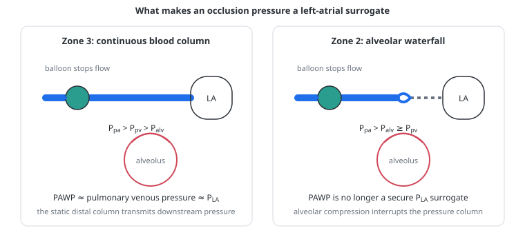

# Pulmonary artery wedge pressure

> A pulmonary artery wedge pressure is a downstream pressure inferred by occluding a pulmonary arterial branch. The model does not perform that occlusion: it displays mean left atrial pressure as a qualified surrogate, which is a useful but narrower claim.

---

## Physiology

### What is actually measured

Inflating the balloon of a pulmonary artery catheter stops flow in a small arterial branch. With no flow, the pressure distal to the balloon equilibrates through the static column of blood in the capillaries and pulmonary veins toward the left atrium. The pressure recorded at the catheter tip is the **pulmonary artery wedge pressure** (PAWP), also called pulmonary artery occlusion pressure.

PAWP is therefore not a direct transduction of the left atrium. It is a pressure transmitted across an occluded vascular path. When that path is unobstructed and the catheter tip lies in a perfused West zone 3 region, mean PAWP is commonly used as a surrogate for mean left atrial pressure. It is not identical to pulmonary capillary pressure, and it is not automatically interchangeable with left ventricular end-diastolic pressure when mitral, pulmonary venous, atrial or ventricular diastolic pathology intervenes.

### Why zone 3 matters

In West zone 3 the pressure order is:

$$
P_{pa} > P_{pv} > P_{alv}
$$

The pulmonary vessels remain open from the occluded branch to the pulmonary veins, so the distal static pressure can track pulmonary venous and left atrial pressure. In zone 2, alveolar pressure exceeds pulmonary venous pressure:

$$
P_{pa} > P_{alv} \ge P_{pv}
$$

The compressed alveolar vessel becomes a vascular waterfall. The continuous pressure column to the left atrium is lost and the occlusion pressure can be governed partly by alveolar pressure rather than by the intended downstream chamber. High lung volume, positive airway pressure and low pulmonary venous pressure make this problem more likely. A real catheter adds regional position, balloon volume, waveform quality and zero-reference errors that the model does not contain.

### The number is referenced to atmosphere, not preload by itself

The transducer reports pressure relative to atmosphere. The pressure distending the left atrium and ventricle is instead referenced to the pressure surrounding the heart. In the simplest form:

$$
P_{LA,tm} = P_{LA} - P_{ext}
$$

- $P_{LA,tm}$ — transmural left atrial pressure, the distending pressure across the atrial wall
- $P_{LA}$ — atmospheric left atrial pressure, approximated clinically by a valid PAWP
- $P_{ext}$ — pressure surrounding the heart, arising mainly from pleural and pericardial pressure

Positive-pressure ventilation can therefore raise measured PAWP while left-heart distension and preload fall. In [eight postoperative cardiac-surgery patients with an open pericardium](https://pubmed.ncbi.nlm.nih.gov/8113561/), increasing PEEP raised wedge pressure while LV end-diastolic area fell. Referencing wedge to measured juxtacardiac pleural pressure restored a positive relation with area. The open-pericardium, intraoperative setting supports the pressure-transmission mechanism but not a universal PEEP correction. Conversely, a vigorous spontaneous inspiration can lower the atmospheric pressure even while the transmural filling pressure rises.

This does not make PAWP useless. It means that the clinical question must be stated: **downstream pulmonary vascular pressure**, **left atrial atmospheric pressure**, and **left-heart transmural filling pressure** are related but not synonymous quantities.

### Its role in heart–lung interaction

PAWP sits at several intersections of respiratory and cardiovascular physiology.

**Pressure transmission.** PEEP and tidal pleural-pressure swings change the atmospheric pressure surrounding the left atrium. A change in PAWP can therefore contain both a change in intracardiac volume and a transmitted external pressure.

**Pulmonary venous return.** Lung inflation can displace blood from the pulmonary vascular reservoir toward the left atrium. That transiently changes left atrial volume and pressure even before altered right ventricular output has crossed the lung.

**Serial ventricular coupling.** Pulmonary storage buffers and spreads the effect of reduced right ventricular delivery on left atrial filling; [pulmonary transit](pulmonary-transit.md) is not a strict delay that excludes immediate pressure-mediated responses. The wedge response to a breath is therefore not a single instantaneous measure of “preload”; it reflects transmission, pulmonary blood displacement and delayed flow in different proportions over time.

**Pulmonary vascular resistance.** Catheter-derived PVR uses PAWP as its downstream term:

$$
PVR = \frac{mPAP - PAWP}{CO}
$$

An invalid PAWP makes the calculation numerically possible but physiologically uncertain. This is why the model propagates wedge caution to the derived-PVR tile.

**Pulmonary hypertension phenotype.** PAWP helps separate pre-capillary from post-capillary haemodynamics. With resting mPAP above 20 mmHg, the ESC/ERS haemodynamic definitions use PAWP at or below 15 mmHg together with PVR above 2 WU for pre-capillary pulmonary hypertension, and PAWP above 15 mmHg for post-capillary disease. Within the latter group, PVR above 2 WU identifies a combined pre- and post-capillary pattern. These thresholds classify a valid invasive haemodynamic measurement in clinical context; they do not validate the model's surrogate.

---

## In the model

### What the tile calculates

There is no catheter, balloon, occluded branch or regional pulmonary venous tree. The left atrium is a compliant chamber whose transmural pressure changes with its volume and atrial activation:

$$
P_{LA,tm}(t) = E_{LA}(t)\left[V_{LA}(t)-V_{0,LA}\right]
$$

The pressure seen relative to atmosphere adds the pressures surrounding the heart:

$$
P_{LA}(t) = P_{LA,tm}(t) + P_{pl}(t) + P_{peri}(t)
$$

- $E_{LA}(t)$ — time-varying atrial elastance
- $V_{LA}$ and $V_{0,LA}$ — current and zero-pressure left atrial volumes
- $P_{pl}$ — pleural pressure converted to mmHg
- $P_{peri}$ — pressure generated by the shared pericardial constraint

The **Wedge surrogate** tile smooths this atmospheric left atrial pressure exponentially, with a three-second time constant:

$$
P_{w,surr}^{n+1} = P_{w,surr}^{n} + \frac{\Delta t}{3\ \mathrm{s}}\left(P_{LA}^{n}-P_{w,surr}^{n}\right)
$$

This smoothing suppresses atrial and respiratory pulsatility for a readable tile. It is not a simulated catheter waveform, an end-expiratory measurement or an automated selection between the a- and v-waves. The label **surrogate** identifies that boundary directly.

The separate **LA transmural pressure** tile uses the same exponential smoothing with a three-second time constant for all its terms:

$$
\overline{P}_{LA,tm}=\overline{P}_{LA}-\overline{P}_{pl}-\overline{P}_{peri}
$$

Because the averaging rule is identical and subtraction is linear, this is also the identically smoothed instantaneous pressure across the model atrial wall. Three seconds is a time constant, not a hard window: older samples retain diminishing weight. It is an exact latent model state, not a bedside measurement reconstructed from an oesophageal catheter.

### How the quality badge is decided

The model cannot identify a regional catheter position. It reports the pressure margin at the downstream end of the alveolar-exposed outlet:

$$
M=P_{pv}-P_{alv}
$$

- $M$ — the **Pv − Palv** margin, in mmHg;
- $P_{pv}$ — pressure in the pulmonary venous compartment relative to atmosphere, in mmHg;
- $P_{alv}$ — alveolar pressure relative to atmosphere, converted to mmHg.

When the margin is negative, pressure inside that end is below the pressure surrounding the alveolar-exposed segment. The middle outlet’s conductance is then reduced by the [narrowing law](vascular-waterfalls.md#on-the-pulmonary-side). For interpretation, the model records the **minimum margin over the last complete breath**. If any sampled phase of that breath had a negative margin, the wedge surrogate remains visible with a caution throughout the next breath. Derived PVR inherits that caution. A currently positive margin does not clear it between phases.

The tile subtitle shows the completed-breath minimum, or says that the measurement is pending; the inspector also retains the instantaneous margin. After a setting change or an airway hold, the model discards the previous result and the partially measured breath. The badge remains cautioned while it awaits one complete uninterrupted breath that began after the change or release of the hold. Depending on the current phase, this can take nearly two respiratory periods. Once that new breath is complete, its minimum determines the badge. A non-negative minimum removes this particular caution but does not prove an uninterrupted regional catheter column or validate a clinical wedge reading.

The instantaneous margin, the completed-breath minimum and the smoothed wedge pressure use three different time windows. The margin and its minimum are pressure differences, not fractions of lung in zone 3 or measurements of capillary recruitment. The geometric resistance reference is independent of the wedge calculation. Derived PVR is unavailable if there is insufficient forward output for meaningful division.

### Reading a PEEP change in the model

When PEEP rises, follow four quantities rather than the wedge tile alone:

1. **Wedge surrogate** — did atmospheric left atrial pressure rise or fall?
2. **Pleural and pericardial pressure** — how much of that change was external pressure transmission?
3. **Left atrial and ventricular volume or LV pressure–volume loop** — did chamber filling actually increase or decrease?
4. **Pv − Palv and its completed-breath minimum, together with the derived-PVR badge** — did any phase place the venous end below alveolar pressure, or is a fresh complete breath still pending?

The transmural tile makes the second and third questions easier to separate. Its lack of a zone 3 caution does not validate the wedge: the model knows its own atrial wall pressure exactly even when a real occluded pulmonary arterial branch would no longer transmit left atrial pressure reliably.

### Worked examples

These examples answer the four questions above with complete, reproducible model states. They are collapsed by default so the page can still be read as a physiological explanation rather than as a catalogue of numbers.

<!-- BEGIN GENERATED: wedge-peep-examples -->

Example 1 — normal passive circulation: the wedge rises while filling falls

*Passive volume control, VT 450 mL and 14/min. Each PEEP level is settled independently for 45 s.*

| PEEP (cmH₂O) | wedge surrogate (mmHg) | mean Ppl (mmHg) | mean Pperi (mmHg) | LA transmural (mmHg) | LA volume (mL) | LVEDV (mL) | CO (L/min) | instantaneous Ppv − Palv (mmHg) | last-breath minimum (mmHg) |
|---:|---:|---:|---:|---:|---:|---:|---:|---:|---:|
| 0 | 7.0 | -3.4 | 0.0 | 10.4 | 67 | 136 | 5.80 | 9.1 | 7.1 |
| 15 | 9.7 | 2.0 | 0.0 | 7.6 | 51 | 122 | 5.16 | -0.1 | -2.4 |

The wedge surrogate rises by 2.6 mmHg, but LA transmural pressure falls by 2.8 mmHg and LVEDV falls by 14 mL. The higher atmospheric pressure therefore reflects external pressure transmission, not greater left-heart filling. A negative instantaneous Ppv − Palv indicates compression at the downstream end of the middle vascular segment. The badge uses the minimum over the last complete breath, shown separately; neither value measures an anatomical zone fraction.

Example 2 — stiff chest wall: stronger pressure transmission and preload loss

*The same passive breath with chest-wall compliance reduced to 75 mL/cmH₂O. Each PEEP level is settled independently for 45 s.*

| PEEP (cmH₂O) | wedge surrogate (mmHg) | mean Ppl (mmHg) | mean Pperi (mmHg) | LA transmural (mmHg) | LA volume (mL) | LVEDV (mL) | CO (L/min) | instantaneous Ppv − Palv (mmHg) | last-breath minimum (mmHg) |
|---:|---:|---:|---:|---:|---:|---:|---:|---:|---:|
| 0 | 6.9 | -3.1 | 0.0 | 10.0 | 65 | 134 | 5.69 | 8.8 | 6.8 |
| 15 | 9.4 | 4.9 | 0.0 | 4.5 | 34 | 98 | 3.97 | -0.8 | -2.6 |

The stiffer thoracic envelope transmits a larger pressure rise around the heart. LA transmural pressure falls by 5.5 mmHg, LVEDV by 36 mL and output by 1.71 L/min despite the higher wedge surrogate.

Example 3 — LV failure: unloading and forward flow

*The LV-failure preset, compared at PEEP 0 and 10 cmH₂O. Each PEEP level is settled independently for 45 s.*

| PEEP (cmH₂O) | wedge surrogate (mmHg) | mean Ppl (mmHg) | mean Pperi (mmHg) | LA transmural (mmHg) | LA volume (mL) | LVEDV (mL) | CO (L/min) | instantaneous Ppv − Palv (mmHg) | last-breath minimum (mmHg) |
|---:|---:|---:|---:|---:|---:|---:|---:|---:|---:|
| 0 | 28.6 | -2.8 | 1.2 | 30.1 | 178 | 186 | 3.11 | 31.2 | 26.4 |
| 10 | 26.2 | 2.6 | 0.1 | 23.5 | 140 | 176 | 2.93 | 20.9 | 16.5 |

The wedge surrogate falls by 2.4 mmHg. Forward output is measured from integrated aortic flow over a completed beat. In this phenotype, reduced transmural ejection pressure coexists with reduced filling and lower mean output; pressure unloading alone does not imply improved cardiac pumping.

Example 4 — severe underfilling: the number remains visible after its catheter meaning weakens

*The normal passive setup after removing 400 mL with Blood volume change. Each PEEP level is settled independently for 45 s.*

| PEEP (cmH₂O) | wedge surrogate (mmHg) | mean Ppl (mmHg) | mean Pperi (mmHg) | LA transmural (mmHg) | LA volume (mL) | LVEDV (mL) | CO (L/min) | instantaneous Ppv − Palv (mmHg) | last-breath minimum (mmHg) |
|---:|---:|---:|---:|---:|---:|---:|---:|---:|---:|
| 0 | 2.3 | -3.4 | 0.0 | 5.7 | 40 | 110 | 4.52 | 3.6 | 2.2 |
| 15 | 5.5 | 2.0 | 0.0 | 3.4 | 28 | 88 | 3.49 | -4.9 | -7.1 |

The wedge surrogate rises by 3.1 mmHg while LA transmural pressure, LVEDV and output all fall. The instantaneous downstream transmural pressure changes from 3.6 to -4.9 mmHg. The minimum over the last complete breath determines the compression caution for wedge and derived PVR. It does not measure a fraction of lung.

<!-- END GENERATED: wedge-peep-examples -->

---

## Why this and not something else

Using left atrial pressure keeps the closed-loop model compact and makes pulmonary venous pressure respond to real chamber volume, external pressure and delayed pulmonary flow. A scripted “wedge” offset would produce a plausible number without explaining where it came from.

A genuine occlusion model would require at least a regional catheter branch, a static distal vascular column, alveolar pressure around that branch and a sampling convention within the cardiac and respiratory cycles. Adding only a balloon button to the current lumped pulmonary bed would imply a measurement fidelity the topology cannot support. The implementation therefore labels the useful downstream signal as a surrogate and qualifies the conditions under which it resembles PAWP.

---

## Limits

### Of the construction

- No regional catheter position, balloon inflation, overwedging, underwedging or waveform-recognition error.
- No mitral stenosis or regurgitation, pulmonary venous obstruction, atrial fibrillation or large pathological v-waves.
- The middle vascular pressure is the pressure of an aggregate alveolar-exposed store. It is not a measured anatomical capillary pressure; neither it nor the wedge surrogate is a hydrostatic oedema threshold. There is no fluid filtration model.
- No end-expiratory sampling. The tile is a low-pass mean of left atrial pressure with a three-second time constant.
- Pv − Palv and its respiratory minimum sample one aggregate pressure difference in a non-regional lung, not an anatomical perfusion map or a complete catheter-validity test.
- The badge describes the last completed breath. It cannot anticipate compression that begins in the current breath before that breath is completed; after a parameter change or hold it remains pending instead of reusing the preceding result.
- The model calculates left atrial pressure exactly from its own state, but exact knowledge of a latent model variable is not equivalent to clinical measurement accuracy.

### Of clinical application

- A value above or below 15 mmHg is not diagnostic when the wedge tracing or zone assumptions are invalid, and the threshold itself must be interpreted with phenotype and measurement context.
- Atmospheric PAWP should not be read as left ventricular preload without considering pleural and pericardial pressure, especially during PEEP, vigorous effort, obesity or dynamic hyperinflation.
- PAWP, LVEDP and mean left atrial pressure can diverge in diseases absent from the model.
- The model's pulmonary hypertension label is descriptive. It cannot replace right-heart catheterisation, waveform review or clinical classification.

---

## Validation

Contract tests check propagation of the completed-breath pressure-margin caution from wedge to derived PVR, including the pending state after a setting change. A non-negative complete-breath minimum removes that particular warning; it does not turn the underlying quantity into a simulated catheter measurement. Pre-/post-capillary labels describe model pressure/flow patterns and retain those interpretability limits.

These checks establish internal consistency: they do not validate the model surrogate against paired human PAWP and left atrial measurements.

---

## References

- Humbert M, Kovacs G, Hoeper MM, et al. 2022 ESC/ERS Guidelines for the diagnosis and treatment of pulmonary hypertension. *Eur Heart J*. 2022;43:3618–3731. [doi:10.1093/eurheartj/ehac237](https://doi.org/10.1093/eurheartj/ehac237)
- West JB, Dollery CT, Naimark A. Distribution of blood flow in isolated lung; relation to vascular and alveolar pressures. *J Appl Physiol*. 1964;19:713–724. [doi:10.1152/jappl.1964.19.4.713](https://doi.org/10.1152/jappl.1964.19.4.713)
- Pinsky MR, Vincent JL, De Smet JM. Estimating left ventricular filling pressure during positive end-expiratory pressure in humans. *Am Rev Respir Dis*. 1991;143:25–31. [doi:10.1164/ajrccm/143.1.25](https://doi.org/10.1164/ajrccm/143.1.25)
- Smiseth OA, Thompson CR, Ling H, Robinson M, Miyagishima RT. Juxtacardiac pleural pressure during positive end-expiratory pressure ventilation: an intraoperative study in patients with open pericardium. *J Am Coll Cardiol*. 1994;23:753–758. [doi:10.1016/0735-1097(94)90764-1](https://doi.org/10.1016/0735-1097(94)90764-1)
- Kovacs G, Avian A, Pienn M, Naeije R, Olschewski H. Reading pulmonary vascular pressure tracings: how to handle the problems of zero leveling and respiratory swings. *Am J Respir Crit Care Med*. 2014;190:252–257. [doi:10.1164/rccm.201402-0269PP](https://doi.org/10.1164/rccm.201402-0269PP)

---

## See also

[Numerical tiles](numeric-tiles.md) · [Interpretability](interpretability.md) · [Transmural pressure](transmural-pressure.md) · [Vascular waterfalls](vascular-waterfalls.md) · [Pulmonary vascular resistance](pulmonary-vascular-resistance.md) · [Pulmonary transit](pulmonary-transit.md) · [The four effects of a breath](the-four-effects-of-a-breath.md)
