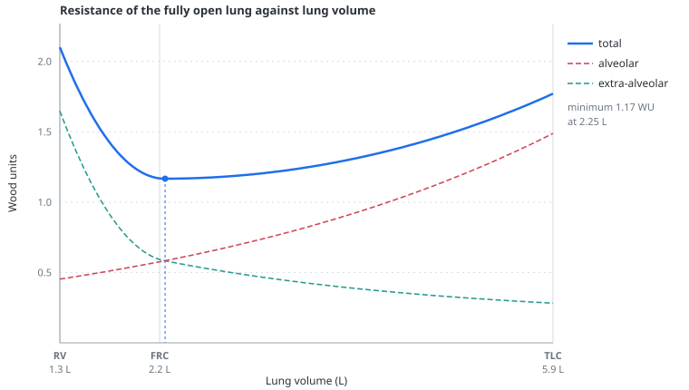

# Pulmonary vascular resistance and the J-curve

> Pulmonary vascular resistance changes with lung volume because alveolar and extra-alveolar vessels respond to inflation in opposite directions. In the model, their combined mechanical contribution is minimal near functional residual capacity, so both derecruitment and overdistension can load the right ventricle.

---

## Physiology

The pulmonary vascular bed can be divided functionally into vessels exposed predominantly to alveolar pressure and vessels supported by extra-alveolar tissue. They differ in surroundings, structure and calibre; the model retains only the distinction in their mechanical response to inflation. See [transmural pressure](transmural-pressure.md).

**Alveolar vessels** are the septal capillaries running in the alveolar wall. The pressure surrounding them is alveolar pressure. As the alveolus inflates, the septum is stretched and flattened, and these vessels are compressed. Their resistance therefore **rises with inflation**.

**Extra-alveolar vessels** are the arterioles and venules travelling in the interstitium between alveoli, along with the larger intraparenchymal vessels. The pressure surrounding them is interstitial pressure, which falls as the lung expands, and they are additionally held open by **radial traction** from the parenchyma attached to their adventitia. Inflating the lung pulls them open. In the classical teaching construction, their resistance therefore **falls with inflation**; at low volume, loss of traction narrows these vessels and raises their resistance. The exact segmental response depends on the experimental preparation and vascular pressures, as discussed below.

Total resistance is the series sum of the two segments:

$$
R_{\text{total}}(V) = R_{\text{alveolar}}(V) + R_{\text{extra-alveolar}}(V)
$$

- $V$ — lung volume
- $R_{\text{alveolar}}$ — resistance of the septal capillaries, which rises with inflation
- $R_{\text{extra-alveolar}}$ — resistance of the interstitial vessels, which falls with inflation

Because the two terms have opposite slopes, the sum has a minimum. Above it, alveolar compression dominates; below it, loss of radial traction does. This is the J-curve — or, drawn symmetrically, the U-curve.

### Why the mechanical curve uses volume

Radial traction is generated by stress in the parenchyma, so transpulmonary pressure is an intuitively attractive horizontal axis. Pressure and volume are not interchangeable during inflation and deflation, however: the lung's own pressure-volume hysteresis lets the same pressure produce different volumes. That separation provides an experimental way to ask which variable better organises the mechanical resistance data.

| if resistance mainly tracks… | plotted against lung volume | plotted against transpulmonary pressure |
|---|---|---|
| **volume** | inflation and deflation points fall approximately on the same curve | a loop may remain because equal pressure does not imply equal volume |
| **pressure** | a loop may remain because equal volume does not imply equal pressure | inflation and deflation points fall approximately on the same curve |

This is a test of which variable is the better **state descriptor in that preparation**, not proof that pressure has no vascular effect.

Thomas, Griffo and Roos used static negative-pressure inflation in excised dog lungs while holding vascular pressures constant. Resistance showed marked inflation-history dependence when plotted against transpulmonary pressure but was relatively consistent when plotted against volume. Hakim, Michel and Chang then compared positive- and negative-pressure inflation in isolated canine lobes and separated arterial, middle and venous pressure drops: they found similar small volume-related increases in alveolar and extra-alveolar resistance, superimposed on pressure-related effects that differed with inflation mode and vascular reference pressure. Peták and colleagues later showed the importance of that distinction directly: over the same 2.5–22 cmH₂O transpulmonary-pressure sweep, total resistance rose by 15 ± 1% with positive-pressure inflation but fell slightly (−3 ± 0.3%) with negative-pressure expansion in isolated perfused rat lungs.

The model uses **strain—volume per open unit—to shape the geometric resistance reference**. It represents pressure effects separately through blood storage and narrowing of the alveolar-exposed outlet. Pressure determines lung volume, changes transmural vascular pressures and drives flow between the represented stores. The geometric curve alone therefore cannot predict flow or the change in pulmonary blood volume.

Three further mechanisms load the low-volume limb in a real patient, and the J-curve of the *mechanically* open lung is only part of the story:

- **Hypoxic vasoconstriction.** Collapsed units are hypoxic, and their vessels constrict. See [hypoxic vasoconstriction](hypoxic-vasoconstriction.md).
- **The alveolar waterfall.** Where alveolar pressure exceeds pulmonary venous pressure, the alveolar segment behaves as a Starling resistor: the effective downstream pressure becomes alveolar rather than venous, and lowering venous pressure further cannot increase flow. This is West zone 2, and it is the same physics as caval collapse on the venous side — see [vascular waterfalls](vascular-waterfalls.md).
- **Derecruitment itself** reduces the conductance of the affected vascular pathways and redistributes perfusion toward the remaining open lung. Closed units can remain perfused.

### Why this matters at the bedside

The right ventricle is sensitive to the pressure against which it ejects — see [the right ventricle](the-right-ventricle.md). The mechanical resistance curve has a minimum near FRC in this teaching construction. Total ventricular load also depends on vascular pressures, flow and arterial compliance; the minimum of a resistance curve alone does not determine the lowest RV ejection pressure or the highest cardiac output. This distinction matters when interpreting either derecruitment or overdistension.

It also explains a clinical trap: raising PEEP in a poorly recruitable lung moves the aerated units up the *right* limb without opening anything, so resistance rises. In a recruitable lung the same PEEP moves collapsed units onto the curve at all, and resistance can fall or stay flat. The PEEP response of pulmonary resistance therefore **interacts with recruitability**; it is not a specific test of recruitability by itself. See [lung opening profiles](recruitment-and-ri.md) and [ARDS with right ventricular failure](scenarios.md#ards-with-right-ventricular-failure).

---

## Following a PEEP change in Arthur

Start with one stable state and Pin it. Change PEEP alone and follow three questions before interpreting the resistance curve:

| question | observations | interpretation limit |
|---|---|---|
| Did more lung participate, or did the open lung mainly expand? | end-expiratory closure, opening excursion, lung volume and transpulmonary pressure | volume gain alone does not quantify recruitment |
| Did pulmonary vascular loading change? | internal resistance coefficient, pulmonary arterial pressure, wedge surrogate and its caution | resistance coefficient and pressure-derived PVR need not change together |
| What was the net circulatory consequence? | RV size and forward output, LV filling and cardiac output | lower resistance alone does not guarantee higher output |

Allow complete breaths and several beats for a persistent comparison. Immediate pulmonary venous emptying and delayed RV-to-LV delivery can differ from the eventual response. The arrows in [Mechanisms](numeric-tiles.md#read-the-shared-mechanisms) describe coupled pathways; they do not isolate the contribution of each one.

## In the model

The **Reference open-lung resistance at FRC** control sets a geometric reference: how the represented bed would resist flow if its alveolar-exposed outlet were distended. It depends on strain in aerated units, the open/closed lung mixture and hypoxic tone. The running circuit additionally includes pressure-dependent narrowing of the middle outlet, three pressure-bearing blood stores and a fixed venous outlet resistance.

Storage, geometry and narrowing are therefore related but distinct. [Pulmonary storage](pulmonary-transit.md) explains how alveolar pressure compresses the middle compartment while parenchymal traction permits extra-alveolar arterial and venous expansion. Intravascular pressures determine filling and flow. Above zero transmural pressure, widening of the already-distended resistance bed is not simulated: its geometric reference is not automatically diluted by a larger stored blood volume.

### Strain, not absolute volume

The limbs are driven by **volume per open unit**, expressed as a strain:

$$
\varepsilon = \frac{V}{V_{\text{unit}} \cdot \varphi} - 1
$$

where $V$ is absolute lung volume, $\varphi$ the open fraction, and $V_{\text{unit}}$ the volume this patient's aerated tissue would hold at resting recoil. That reference follows both aerated-lung compliance and maximum capacity. A small aerated lung can therefore be **distended** at an absolute volume well below a healthy 2.2 L FRC. Referencing strain to a fixed healthy FRC would make that lung appear under-inflated at high plateau pressure, which is the opposite of what it is. See [the two-population lung](two-population-lung.md) for how $\varphi$ and $V_{\text{unit}}$ are obtained.

### The two limbs

The following two limbs construct the open pathway’s geometric reference, per unit of lung. They describe the reference shape. Their allocation to the running circuit is explained below: resistance added above the neutral setting is placed before the middle store, so the plotted extra-alveolar/upstream component also contains that added precapillary load.

$$
R_{\text{alv}} = P \cdot f_a \, e^{k\varepsilon}
$$

$$
R_{\text{extra}} = P \cdot \Big[ f_e \big( c + (1-c)\,e^{-K\varepsilon} \big) + G \cdot \max(0, -\varepsilon)^2 \Big]
$$

- $\varepsilon$ — strain, defined above; zero at resting recoil, negative below it
- $P$ — the `pvrBase` control, which sets the scale of the whole bed
- $f_a = f_e = 0.5$ — the shares of resting resistance assigned to each segment
- $k = 0.58$ — how steeply the alveolar limb rises with stretch
- $c = 0.30$ — the floor the extra-alveolar limb decays toward as the lung inflates
- $G = 4$ — the gain of the low-volume traction term, active only below resting recoil

$K$ is **derived rather than chosen**. Requiring the total to be stationary at $\varepsilon = 0$ gives

$$
\frac{dR}{d\varepsilon}\bigg|_{0} = P\big(f_a k - f_e(1-c)K\big) = 0
\quad\Longrightarrow\quad
K = \frac{f_a k}{f_e (1-c)} = 0.829
$$

so the minimum sits at zero strain by construction, not by tuning. The quadratic $G$ term is zero in both value and slope at $\varepsilon = 0$, so it steepens the left limb without moving that minimum or changing the resistance assigned there.

Zero strain means the volume the completely open tissue holds at resting recoil, which for the default lung is 2.25 L against a nominal whole-lung FRC of 2.2 L. The small difference is the residual opening behaviour of normal units at 5 cmH₂O; the executable row below allows 0.15 L between them.

### Open and closed beds in parallel

Derecruited units are poorly perfused, not unperfused. Each population's conductance is proportional to how much lung belongs to it, and conductances add:

$$
\frac{1}{R_{\text{total}}} = \frac{\varphi}{R_{\text{open}}} + \frac{1-\varphi}{R_{\text{closed}}},
\qquad R_{\text{closed}} = P \cdot 3 \cdot \big(1 + 1.1\,h\big)
$$

- $\varphi$ — open fraction of the lung, so $1-\varphi$ is the derecruited fraction
- $R_{\text{open}}$ — resistance per unit of open lung, the series sum of the two limbs above
- $R_{\text{closed}}$ — resistance per unit of derecruited lung
- $P$ — the `pvrBase` control
- $h$ — the [hypoxic vasoconstriction](hypoxic-vasoconstriction.md) control

HPV raises **only the closed pathway**. The closed fraction is used as a surrogate for the territory receiving selective vasoconstrictor tone. There is no calculated alveolar or arterial oxygen tension and no oxygen-driven feedback.

### Where the reference resistance acts

The parallel open/closed calculation produces one equivalent geometric coefficient. The ordinary reference bed is partitioned using the open pathway's alveolar/extra-alveolar proportions. Half its extra-alveolar part lies between PA and the middle store and half between PV and LA; the latter also includes a fixed 0.008 mmHg·s/mL outlet resistance. Its alveolar part lies at the middle-to-PV connection. These are aggregate assignments, not measured anatomical partitions.

The additional resistance from a selected baseline above the neutral 0.07 mmHg·s/mL reference, and the additional resistance associated with HPV, are placed upstream of the middle store. Thus a high-resistance or HPV phenotype adds precapillary load without turning the same intervention into venous obstruction. The total geometric coefficient remains the open/closed mixture. This location choice does not resolve clot anatomy, individual arteries or regional HPV.

When that middle outlet is distended along its length, its flow is the pressure difference divided by its geometric resistance. If internal pressure falls below alveolar pressure, its conductance decreases smoothly. Both endpoint pressures enter the same signed relation, so flow can reverse and is zero at equal pressures. See [vascular waterfalls](vascular-waterfalls.md#on-the-pulmonary-side) for the equation and its limitations.

The open/closed mixture describes reference conductance. It does not give each population a separate blood store, pressure or external pressure. In particular, the middle compartment uses global alveolar pressure even when some lung is compromised. This limits comparisons with regional ARDS perfusion and with measured segmental resistance.

### Pressure, ventricular load and flow are coupled

A higher PA pressure increases the gradient into the middle store and simultaneously opposes RV ejection through the pulmonary valve. A higher venous or LA pressure can impede downstream delivery while increasing blood stored upstream. The flows change compartment volumes; their pressure–volume relations then change the pressures driving the next transfer.

Raising alveolar pressure affects both middle-compartment pressure and its outlet conductance. It can expel blood already present, obstruct incoming delivery, or coexist with extra-alveolar accumulation. The result cannot be inferred from one coefficient alone. All three vascular connections permit pressure-driven reversal, with the same volume subtracted from the donor and added to the receiving compartment.

A lower geometric reference therefore does not guarantee lower RV ejection pressure or greater cardiac output. Read PA and LA pressures, pulmonary blood storage, RV filling and actual forward output together. The [PVR panel](panel-pvr-curve.md) deliberately labels the geometric reference separately from the current pressure-sensitive segmental resistance sum and the catheter-style ratio.

### What the fully open normal lung does

<!-- BEGIN GENERATED: pvr-landmarks -->
*Executable setup: fully open reference lung, no HPV; static evaluation of the internal mechanical resistance coefficient, without a ventilatory manoeuvre or a catheter measurement.*

| | zero-transpulmonary-pressure reference (1.27 L) | FRC reference (2.20 L) | capacity limit (6.00 L) |
|---|---:|---:|---:|
| total coefficient (WU) | 2.10 | 1.17 | 1.81 |
| relative to the FRC minimum | 1.80× | 1.00× | 1.55× |
| extra-alveolar ÷ alveolar | 3.64 | 1.03 | 0.18 |
<!-- END GENERATED: pvr-landmarks -->

The crossover — the volume at which the dominant mechanism changes — sits at FRC, which is the teaching point the figure exists to make.

The point labelled “RV” is the model's low-volume reference at zero transpulmonary pressure. Residual volume is not independently modelled, so the label should not be interpreted as a predicted physiological RV.

### Three resistance quantities with different meanings

- **Pulmonary resistance reference** is the instantaneous geometric coefficient determined by lung inflation, opening and HPV. It describes the aggregate bed with its middle outlet distended. The graph displays this reference, not the full pressure-sensitive circuit load.
- **Current segmental resistance sum** adds the effective resistance of the three vascular connections at their current pressures. It includes middle-outlet narrowing and the fixed venous outlet resistance. During redistribution the three flows differ, so this sum is not the ratio of the entire PA-to-LA gradient to any single instantaneous flow.
- **PVR, derived** is $(\overline P_{pa}-\overline P_{la})/CO$, using smoothed atmospheric pressures and last-completed-beat aortic output. It resembles catheter PVR only under appropriate [wedge-surrogate](pulmonary-artery-wedge-pressure.md) conditions. Different sampling windows, storage and narrowing can make it differ from both quantities above.

They can move in opposite directions. The derived value includes the downstream-pressure effects, pulsatile storage and averaging choices as well as flow in its denominator; it is not obtained simply by reading the internal resistor. A fall in flow alone would not change the ratio in an ideal steady resistor if its pressure gradient fell proportionally. In the research calibration phenotype, compare PEEP 4 and 14 cmH₂O at fixed low and high reopenable shares of the same compromised component:

<!-- BEGIN GENERATED: pvr-opening-peep -->
*Executable setup: the shared literature-check phenotype, distinct from the shipped ARDS/RV preset: passive volume control, VT 350 mL, 24/min, aerated-lung compliance 40 mL/cmH₂O, 42% compromised, transpulmonary opening midpoint 17.5 cmH₂O, opening memory off, baroreflex on, baseline pulmonary coefficient 0.09 mmHg·s/mL and HPV multiplier 1.6. Each PEEP level is initialized independently and run for 45 additional s after automatic initialization, rather than reached by a sequential PEEP step.*

| reopenable share | geometric reference (WU), PEEP 4 → 14 | pressure–flow estimate (WU), PEEP 4 → 14 | open fraction at sampling, PEEP 4 → 14 |
|---|---:|---:|---:|
| low (6.2% of compromised lung) | 2.41 → 2.40 (−0.4%) | 2.60 → 3.61 (+38.8%) | 58 → 61% |
| high (75.0% of compromised lung) | 2.38 → 1.72 (−28.0%) | 2.39 → 2.39 (−0.2%) | 59 → 89% |

The geometric reference and open fraction are instantaneous samples at the end of that run, not respiratory means or dedicated end-expiratory measurements. The pressure–flow estimate combines pulmonary arterial and left atrial pressures smoothed with a 3 s exponential time constant (both relative to atmosphere) with forward aortic output from the last completed heartbeat. The displayed changes compare those specified samples; their size is not an independently validated clinical effect.
<!-- END GENERATED: pvr-opening-peep -->

The coefficient and pressure–flow estimate answer different questions. Check the instantaneous Pv − Palv margin, its completed-breath minimum and the wedge caution separately at each sampled state. This table compares internal model responses and their dependence on opening; it does not independently validate a human catheter measurement or a universal PEEP response.

---

## Why this and not something else

### The minimum is placed at FRC, and this is a genuine choice

The fully open mechanical minimum is constructed at zero strain, near the tissue's resting volume. This follows the clinical teaching geometry of a minimum near FRC. Primary measurements in isolated animal lungs support opposing mechanical effects but can place the minimum nearer half maximal volume; that location is not treated as a measured human target.

The reference geometry combines open and closed conductances in parallel, HPV confined to the closed pathway and the strain-dependent open pathway. Pressure-bearing storage and smooth middle-outlet narrowing determine the running circuit response. The evidence serves several distinct roles:

1. **Human in-vivo catheter measurements** provide an external comparison for the magnitude and recruitability-dependent PEEP response of a selected phenotype. Cappio Borlino and colleagues studied 23 patients with ARDS with a 10 cmH₂O PEEP difference and classified recruitability using measured R/I. The model uses explicit opening shares; those coefficients do not estimate the patients' anatomy. A pressure-sensitive circulation must be reassessed under matched measurement conditions rather than inheriting a validation claim from its reference geometry.
2. **The contemporary clinical synthesis** supplies the human teaching topology: a minimum near FRC with resistance rising toward both lower and higher volume.
3. **Isolated-animal preparations** support volume dependence and the existence of opposing mechanical effects, but their exact nadir and maximal-inflation ratios are not numerical human targets.

The nadir is consequently at FRC *by construction*—$K$ is solved to put it there—not because the model discovered or fitted its location. The model cannot be used to ask where the human nadir truly belongs, and anyone teaching from the figure should state that boundary.

### The reference geometric limbs follow volume

The experimental argument is described [above](#why-the-mechanical-curve-uses-volume). It supports volume as an organising variable for the model’s **mechanical curve**. Strain describes inflation of aerated units; vascular pressures separately determine filling, flow and outlet narrowing. Hakim’s and Peták’s inflation-mode results show why this distinction matters: pressure-related effects remain real even when volume better organises the mechanical relation in a particular preparation.

### Conductances in parallel, not a divided single path

The two populations contribute parallel reference conductances. The closed pathway retains conductance, and HPV reduces it. This mixture varies continuously with open fraction. Its equivalent coefficient is then assigned to the aggregate pressure-bearing circuit; there is no separate regional flow measurement or blood store for each population.

### Coefficients that are declared rather than cited

Several numbers here are **didactic shape coefficients**: they were chosen to express a physiological principle that is well established but has never been quantified in a form portable to a human aggregate model. They carry no citation because attaching one would misrepresent them.

| | value | what it does |
|---|---|---|
| $f_a : f_e$ | 50 : 50 | where the dominant mechanism changes |
| $k$, $c$ | 0.58, 0.30 | how gradually each limb rises |
| $G$ | 4 | the nonlinear left limb below FRC |
| closed-path factor | 3 | how much narrower a derecruited pathway is |

Published partitions of pulmonary resistance depend on the preparation and measurement method. An occlusion-defined middle segment is not necessarily identical to anatomical septal capillaries, and viscosity can change the observed distribution of pressure drops. Equal reference shares at FRC therefore specify a didactic crossover, not a measured anatomical split. The same limitation applies to assigning half the extra-alveolar reference resistance to each side of the middle store.

The closed-path factor and phenotype were constrained jointly against the numerical pattern of a human PEEP study. Because the model uses left atrial pressure as the downstream pressure even when its wedge surrogate is cautioned, this is calibration of an internal phenotype rather than independent validation of catheter-derived PVR.

---

## Limits

### Of the construction

- One aggregate bed. There is no regional zonal network, gravitational gradient or distribution of perfused paths. The middle store uses global alveolar pressure, including when lung is compromised.
- Pressure-dependent middle-outlet narrowing is represented. Pressure-driven widening or recruitment of an already-distended resistance bed is not. Stored blood volume does not uniquely identify calibre, length or the number of flowing vessels.
- No blood rheology. Viscosity and haematocrit do not exist, although the partition they most affect is one of the model's chosen constants.
- No vascular remodelling, characteristic impedance or wave reflection. Pulmonary pressures and flows vary through three compliant stores, but there is no distributed pressure-wave propagation or independently imposed blood-delivery delay. See [storage and transit](pulmonary-transit.md).
- HPV is a gain applied to the derecruited pathway, not a response to a measured oxygen tension. There is no gas exchange, no V/Q, no CO₂.
- The secondary high-volume rise found outside the alveolar segment in isolated lobes is not represented; the clinical two-limb decomposition is followed instead.
- The minimum is at FRC by construction. See the caveat above.

### Of clinical application

- **Do not read the coefficient as a patient's PVR.** It is an internal quantity. The value labelled *derived* is comparable in form to catheter PVR only when the left-atrial-pressure wedge surrogate is valid.
- **Absolute pressure–flow responses remain quantitatively unvalidated.** The PEEP 4–14 comparison uses one selected phenotype and one human ARDS cohort. Matching a numerical interval without matching vascular pressure references, respiratory phase and wedge conditions would not establish catheter-level validation.
- **This is not a PEEP titration tool.** A large reopenable share does not establish that high PEEP is safe, and the model does not turn the PEEP response of resistance into a recommendation.
- **In the pulmonary embolism preset**, a raised `pvrBase` is an *effective aggregate load*. It reproduces the pressure, flow and right-ventricular consequences of obstruction without representing clot burden, embolic distribution or a right-shifted pressure–flow relation as separate quantities. See [acute pulmonary embolism](scenarios.md#acute-pulmonary-embolism).
- Nothing here defends right ventricular **coronary** perfusion, which is absent from the model and is a real part of the clinical spiral.

---

### What the isolated-lung comparisons do and do not establish

Applying the experimental pressure references to the nominal adult model gives only partial agreement with the supplied animal experiments. In a Peták-style comparison, PA and LA pressures are fixed relative to atmosphere while the lung is inflated by positive airway pressure or negative surrounding pressure. The endpoint directions agree, but positive-pressure inflation produces a much larger resistance increase in the model, and the full negative-pressure trajectory is not reproduced quantitatively. The comparison uses adult teaching coefficients without scaling species, lung size or perfusate; it is not a replication of the rat experiment.

In a Hakim-style constant-inflow comparison, positive-pressure inflation mainly increases the middle pressure drop, as in the canine experiment. The model's extra-alveolar/venous pressure drop nevertheless falls where the measured venous drop rises slightly at high inflation. The falling extra-alveolar geometric limb cannot reproduce that component of the experiment. Moreover, an occlusion-defined experimental segment is not identical to the model's compartment boundaries.

Roos-style pressure sweeps reproduce selected effects of releasing compression. They do not establish the additional distension-dependent reduction in resistance that can occur when vessels are already open, which this construction omits. These discrepancies limit quantitative and segmental interpretation; agreement in a whole-lung direction does not validate every constituent mechanism.

## Validation

Five rows in [`LITERATURE_RANGES.md`](../docs/LITERATURE_RANGES.md) are executed by the test suite against this page's behaviour, and fail the build if the model drifts. See [validation](validation.md) for what a green row means.

| row | constrains |
|---|---|
| `pvr-human-frc-nadir` | the minimum lies within 0.15 L of FRC |
| `pvr-human-j-direction` | higher at RV and TLC than at FRC; extra-alveolar predominates at RV, alveolar at TLC |
| `pvr-recruitability-low` | model pressure–flow estimate inside the low-recruiter IQRs, rising with PEEP |
| `pvr-recruitability-high` | model pressure–flow estimate inside the high-recruiter IQRs, near-flat with PEEP |
| `pvr-recruitability-dissociation` | across explicit reopenable-share fixtures from 0 to 100%, the PEEP-related rise is progressively attenuated |

The first two are topological: they test the shape, not a fitted number, because the shape is what this page teaches and the schematic it follows has no quantitative y-axis. The cohort-range tests are regression constraints on the chosen phenotype, not proof that the downstream pressure is measurable as a wedge under every tested condition.

---

## References

**Design sources**

- Cecconi M, Collino F, Pinsky MR. Heart–lung interactions in ARDS: practical bedside implications. *Intensive Care Med* 2026;52:2031–2034. [doi:10.1007/s00134-026-08583-3](https://doi.org/10.1007/s00134-026-08583-3) — Fig. 1C is the clinical two-limb synthesis this page follows.
- Mahmood SS, Pinsky MR. Heart–lung interactions during mechanical ventilation: the basics. *Ann Transl Med* 2018;6:349. [doi:10.21037/atm.2018.04.29](https://doi.org/10.21037/atm.2018.04.29)
- Kenny J-ÉS. *An Approach to Mechanical Heart–Lung Interaction*, 2020.
- Yuriditsky E, Mireles-Cabodevila E, Alviar CL. How I Teach: Heart–Lung Interactions during Mechanical Ventilation. Positive Pressure and the Right Ventricle. *ATS Scholar* 2025;6:94–108. [doi:10.34197/ats-scholar.2024-0059HT](https://doi.org/10.34197/ats-scholar.2024-0059HT)

**Volume dependence of pulmonary vascular resistance**

- Thomas LJ, Griffo ZJ, Roos A. [Effect of negative-pressure inflation of the lung on pulmonary vascular resistance](https://doi.org/10.1152/jappl.1961.16.3.451). *J Appl Physiol* 1961;16:451–6. Excised dog lungs; resistance minimal near half maximal volume, rising on either further inflation or deflation.
- Whittenberger JL, McGregor M, Berglund E, Borst HG. [Influence of state of inflation of the lung on pulmonary vascular resistance](https://doi.org/10.1152/jappl.1960.15.5.878). *J Appl Physiol* 1960;15:878–82.
- Hakim TS, Michel RP, Chang HK. [Effect of lung inflation on pulmonary vascular resistance by arterial and venous occlusion](https://doi.org/10.1152/jappl.1982.53.5.1110). *J Appl Physiol* 1982;53:1110–5. Positive- and negative-pressure inflation separated volume-related from pressure-reference effects.
- Hakim TS, Michel RP, Chang HK. [Partitioning of pulmonary vascular resistance in dogs by arterial and venous occlusion](https://doi.org/10.1152/jappl.1982.52.3.710). *J Appl Physiol* 1982;52:710–5. Methodological basis for the segmental pressure-drop partition.
- Peták F, Albu G, Lele E, et al. [Lung mechanical and vascular changes during positive- and negative-pressure lung inflations: importance of reference pressures in the pulmonary vasculature](https://doi.org/10.1152/japplphysiol.00831.2007). *J Appl Physiol* 2009;106:935–42.
- Simmons DH, Linde LM, Miller JH, O'Reilly RJ. [Relation between lung volume and pulmonary vascular resistance](https://doi.org/10.1161/01.RES.9.2.465). *Circ Res* 1961;9:465–71.

**The waterfall and zonal behaviour**

- West JB, Dollery CT, Naimark A. [Distribution of blood flow in isolated lung; relation to vascular and alveolar pressures](https://doi.org/10.1152/jappl.1964.19.4.713). *J Appl Physiol* 1964;19:713–24.
- Permutt S, Bromberger-Barnea B, Bane HN. Alveolar pressure, pulmonary venous pressure and the vascular waterfall. *Med Thorac* 1962;19:239–60. [doi:10.1159/000192224](https://doi.org/10.1159/000192224)

**Hypoxic vasoconstriction**

- von Euler US, Liljestrand G. Observations on the pulmonary arterial blood pressure in the cat. *Acta Physiol Scand* 1946;12:301–20. [doi:10.1111/j.1748-1716.1946.tb00389.x](https://doi.org/10.1111/j.1748-1716.1946.tb00389.x)
- Sylvester JT, Shimoda LA, Aaronson PI, Ward JPT. [Hypoxic pulmonary vasoconstriction](https://doi.org/10.1152/physrev.00041.2010). *Physiol Rev* 2012;92:367–520.

**Human in-vivo calibration and clinical consequence**

- Cappio Borlino S, et al. [The effect of positive end-expiratory pressure on pulmonary vascular resistance depends on lung recruitability in patients with acute respiratory distress syndrome](https://doi.org/10.1164/rccm.202402-0383OC). *Am J Respir Crit Care Med* 2024;210:900–7. Human pressure–flow comparison used to constrain an illustrative model phenotype, not independent validation of its internal coefficient or of a whole human J-curve.
- Chen L, Del Sorbo L, Grieco DL, et al. [Potential for lung recruitment estimated by the recruitment-to-inflation ratio in ARDS: a clinical trial](https://doi.org/10.1164/rccm.201902-0334OC). *Am J Respir Crit Care Med* 2020;201:178–87.
- Mekontso Dessap A, et al. [Acute cor pulmonale during protective ventilation for ARDS: prevalence, predictors and clinical impact](https://doi.org/10.1007/s00134-015-4141-2). *Intensive Care Med* 2016;42:862–70.
- Paternot A, Repessé X, Vieillard-Baron A. [Rationale and description of right ventricle-protective ventilation in ARDS](https://doi.org/10.4187/respcare.04943). *Respir Care* 2016;61:1391–6.

---

## See also

[The two-population lung](two-population-lung.md) · [Lung opening profiles](recruitment-and-ri.md) · [Vascular waterfalls](vascular-waterfalls.md) · [Hypoxic vasoconstriction](hypoxic-vasoconstriction.md) · [The right ventricle](the-right-ventricle.md) · [Transmural pressure](transmural-pressure.md) · [Interpretability](interpretability.md) · [The PVR curve panel](panel-pvr-curve.md) · [ARDS with right ventricular failure](scenarios.md#ards-with-right-ventricular-failure)
