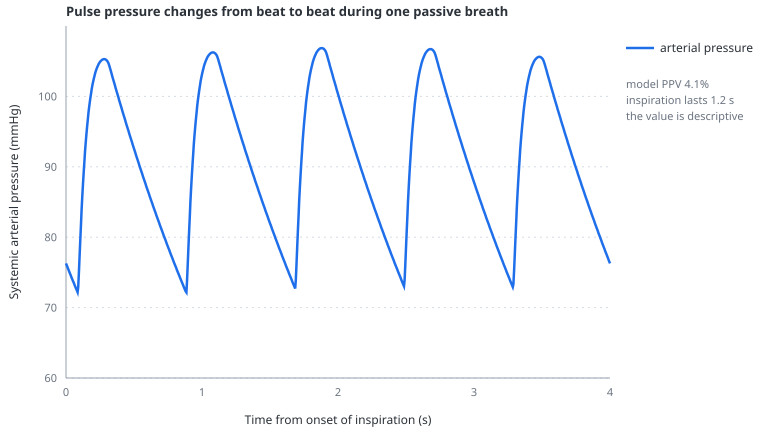
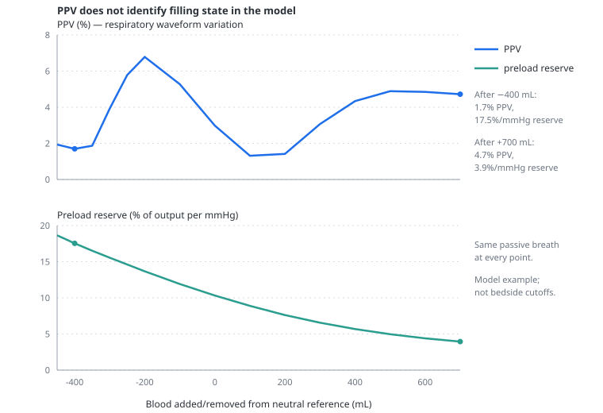

# Pulse pressure variation

> PPV describes how arterial pulse pressure changes over a breath; under strict conditions that variation can reflect biventricular preload responsiveness, but the model does not turn it into a fluid-response diagnosis.

---

## Physiology

Pulse pressure is systolic minus diastolic arterial pressure for one beat. During passive positive-pressure ventilation, inspiration changes venous return, right-ventricular filling, pulmonary vascular load and left-ventricular filling in sequence. If both ventricles operate on the ascending part of their cardiac function curves, these cyclic changes produce a larger swing in stroke volume and pulse pressure.

PPV is conventionally calculated over one respiratory cycle:

$$
PPV = 100\,\frac{PP_{max}-PP_{min}}{\left(PP_{max}+PP_{min}\right)/2}
$$

- $PPV$ — pulse pressure variation, %
- $PP_{max}$ — largest beat pulse pressure during the respiratory cycle, mmHg
- $PP_{min}$ — smallest beat pulse pressure during the respiratory cycle, mmHg

The illustration shows one inspiration-aligned waveform interval. Its annotated PPV is the simulator's trailing beat-window calculation described below; it is not recomputed from precisely the displayed endpoints.

The formula is simple; the physiology is not. The pulmonary circulation stores blood and spreads the effect of reduced RV delivery over time; its influence on LV filling need not coincide with the initial right-sided perturbation. This [pulmonary buffering](pulmonary-transit.md) is distinct from tracer transit and does not prevent immediate pressure-mediated effects. Direct inspiratory emptying of pulmonary venous blood can briefly increase LV filling, while a later fall in RV output can reduce it. The resulting maximum and minimum depend on the ratio of heart rate to respiratory rate as well as on loading.

Large PPV is not synonymous with hypovolaemia. Right-ventricular dysfunction or a large cyclic increase in pulmonary vascular load can create a false positive. Low tidal volume can create a false negative. Spontaneous or irregular effort, arrhythmia, abdominal hypertension and too few beats per breath further weaken the interpretation.

---

## In the model

The simulator records systolic and diastolic pressure for each completed model beat. It selects completed beats in a moving window slightly longer than the current nominal respiratory period (1.05 times that period), calculates pulse pressure for each, and applies the standard formula above. This is not a phase-latched complete breath. If fewer than two recent beats exist, it falls back to up to four previous beats; if there are still fewer than two, it returns zero. A startup zero or a value spanning a recent setting change must not be interpreted as absence of physiological variation.

PPV remains a descriptive number, accompanied by [interpretability](interpretability.md):

- spontaneous effort makes it **unavailable**;
- delivered VT below 560 mL — 8 mL/kg for the fixed <!-- CONSISTENCY: reference-weight -->70 kg<!-- /CONSISTENCY --> reference — produces a **caution**;
- fewer than 3.6 beats per breath produces a **caution**;
- RV/LV end-diastolic volume ratio above 1.2 produces a **caution** because afterload may dominate;
- selected baseline abdominal pressure above 12 cmH₂O produces a **caution**. This internal threshold is in cmH₂O, not the clinical intra-abdominal-hypertension criterion in mmHg.

The model has no arrhythmia, so regular rhythm is always present and cannot be checked. Low respiratory-system compliance is not by itself a badge rule, although the simulator exposes the within-breath PVR swing and RV dilatation that can reveal the mechanism.

There is no diagnostic PPV threshold or automatic tidal-volume-challenge interpretation. The ventilation and population of a published cohort do not justify transporting a single regression into every scenario. PPV amplitude is not quantitatively calibrated across the control space, so a model-specific change during a tidal-volume manoeuvre cannot establish clinical fluid responsiveness.

The model's PPV is non-monotonic at **both** ends of the filling range.

At severe underfilling, a small PPV can coexist with marked [preload reserve](preload-reserve.md). Two represented mechanisms contribute. First, low pulmonary venous pressure reduces the aggregate zone-3 pressure-margin index. Arthur uses that index to attenuate its piston term, so the simulated immediate displacement toward the LA becomes small. This is a model gating assumption, not a regional measurement of capillary patency. Second, low cardiac output lengthens transit through the compliant pulmonary circulation, which can blunt the right-sided variation before it appears in left-ventricular output. The arterial waveform can therefore vary little even though more filling would raise output substantially. This is a quantitative limitation of the model, **not** a clinical rule about profound hypovolaemia.

At the filled end, the opposite problem appears. When the aggregate zone-3 pressure-margin index approaches one, inflation can squeeze blood toward the left atrium and raise PPV again even when additional filling buys little output. The figure places the model's PPV above its independent preload-reserve readout across the same filling sweep.

Each point uses a separate settled prescription with the same passive breath. The horizontal axis expresses added or removed blood relative to the neutral starting volume. PPV is averaged over a further 30 seconds; preload reserve uses the final respiratory-window calculation. These are illustrative model comparisons, not paired clinical measurements or an infusion time series.

The practical reading is deliberately simple: neither a low nor a high model PPV identifies filling state or fluid responsiveness. Use PPV to observe respiratory waveform variation; read the RV preload-reserve coefficient as a local analytical slope, and use an actual blood-volume application to observe the intact model's output response. The coefficient does not independently establish LV reserve.

---

## Why this and not something else

Removing PPV entirely would discard one of the clearest demonstrations of heart–lung interaction. Keeping the waveform calculation while removing the diagnostic verdict preserves the useful observation: ventilation changes arterial pulse amplitude, and the mechanism depends on loading, timing and RV afterload.

The simulator does not normalise PPV for tidal volume, compliance or driving pressure. Such corrections may improve performance in selected studies but would imply a quantitative calibration the model does not possess.

---

## Limits

### Of the construction

- Cardiac rhythm and prescribed respiratory drive are regular; arrhythmia and variable neural effort are absent. Pressure support can produce delayed or ineffective triggering, but this is not a complete dyssynchrony model.
- Pulse pressure comes from one lumped systemic arterial compliance with no wave reflection, peripheral amplification or damping by an arterial catheter system.
- The model represents cyclic RV afterload through an aggregate pulmonary bed, not regional ARDS perfusion.
- The 70 kg reference used for the tidal-volume caution is fixed and is not a patient weight control.
- The model's PPV amplitude is not calibrated across disease populations.

### Of clinical application

- No PPV value in the simulator should trigger fluid administration.
- A low value does not exclude preload responsiveness under low VT or weak cardiopulmonary transmission.
- A high value can reflect RV afterload, abdominal pressure or other confounding mechanisms rather than preload reserve.
- The value is deliberately unavailable during spontaneous breathing even though a mathematical respiratory variation still exists.

---

## Validation

Executable checks require PPV to be withheld during spontaneous breathing, qualified at low tidal volume and with RV dilatation, and prevented from masquerading as preload reserve when pulmonary venous piston effects raise variation at high filling. Separate tests require the timing of the LV response to remain consistent with pulmonary transit.

---

## References

[Mahjoub et al.](https://pubmed.ncbi.nlm.nih.gov/19623051/) studied 35 mechanically ventilated patients selected for PPV above 12%; 12 did not increase stroke volume sufficiently after 500 mL colloid. RV tissue-Doppler findings distinguished these false positives. This supports checking RV function, not Arthur's particular RV/LV volume-ratio cutoff.

- Michard F, Boussat S, Chemla D, et al. Relation between respiratory changes in arterial pulse pressure and fluid responsiveness in septic patients with acute circulatory failure. *Am J Respir Crit Care Med*. 2000;162:134–138. [doi:10.1164/ajrccm.162.1.9903035](https://doi.org/10.1164/ajrccm.162.1.9903035)
- De Backer D, Heenen S, Piagnerelli M, Koch M, Vincent JL. Pulse pressure variations to predict fluid responsiveness: influence of tidal volume. *Intensive Care Med*. 2005;31:517–523. [doi:10.1007/s00134-005-2586-4](https://doi.org/10.1007/s00134-005-2586-4)
- Mahjoub Y, Pila C, Friggeri A, et al. False-positive pulse pressure variation is detected by Doppler evaluation of the right ventricle. *Crit Care Med*. 2009;37:2570–2575. [doi:10.1097/CCM.0b013e3181a380a3](https://doi.org/10.1097/CCM.0b013e3181a380a3)
- Vieillard-Baron A, Chergui K, Augarde R, et al. Cyclic changes in arterial pulse during respiratory support revisited by Doppler echocardiography. *Am J Respir Crit Care Med*. 2003;168:671–676. [doi:10.1164/rccm.200301-135OC](https://doi.org/10.1164/rccm.200301-135OC)
- Teboul JL, Monnet X, Chemla D, Michard F. Arterial pulse pressure variation with mechanical ventilation. *Am J Respir Crit Care Med*. 2019;199:22–31. [doi:10.1164/rccm.201801-0088CI](https://doi.org/10.1164/rccm.201801-0088CI)
- Hamzaoui O, Shi R, Carelli S, et al. Changes in pulse pressure variation to assess preload responsiveness in mechanically ventilated patients with spontaneous breathing activity. *Br J Anaesth*. 2021;127:532–538. [doi:10.1016/j.bja.2021.05.034](https://doi.org/10.1016/j.bja.2021.05.034)

---

## See also

[The four effects of a breath](the-four-effects-of-a-breath.md) · [Pulmonary transit](pulmonary-transit.md) · [Preload reserve](preload-reserve.md) · [Interpretability](interpretability.md) · [The right ventricle](the-right-ventricle.md)
