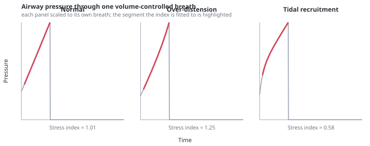

# The stress index

> The shape of the airway pressure curve during a passive constant-flow breath indicates whether global compliance changes through inspiration. Opening and upper-limb stiffening are possible explanations; chest-wall mechanics also contribute.

---

## Physiology

During volume control with a constant inspiratory flow, volume rises linearly with time. If compliance were constant, airway pressure would rise linearly too. It usually does not, and the direction it bends says which way compliance is moving:

$$
P_{aw}(t) = a\,t^{\,b} + c
$$

- $P_{aw}$ — airway pressure during inspiration, cmH₂O
- $t$ — time from the start of inspiration, s
- $b$ — the **stress index**, dimensionless
- $a$, $c$ — scale and offset, fitted with it

$b > 1$ — pressure rises faster than linearly. Respiratory-system compliance is falling as the breath proceeds. Approaching the upper limb of the lung [pressure–volume curve](pressure-volume-curve.md) is one explanation; the index alone does not establish regional overdistension or tissue injury.

$b \approx 1$ — the global pressure rise is nearly linear over the fitted interval. This does not prove that all regions behave uniformly or that ventilation is safe.

$b < 1$ — pressure rises more slowly than linearly. Compliance is *improving* as the breath proceeds; intratidal recruitment is one important cause. At the bedside this does not, by itself, prescribe a higher PEEP.

The index requires constant flow and a passive patient. Any effort during inspiration deforms the curve for reasons that have nothing to do with the tissue, and pressure control makes the question meaningless because flow is not constant.

---

## In the model

Airway pressure is sampled through each constant-flow inspiration and fitted once per breath, at the moment the breath ends.

The fitted curve belongs to the **whole respiratory system**, not to isolated lung tissue. The model's independent chest wall is close to linear around ordinary tidal breathing, so recruitment and lung upper-limb stiffening usually dominate the curvature in the examples below. At extreme volume, very low chest-wall compliance or a large wall load, chest-wall curvature can also contribute. The index should therefore be read as “compliance is changing during inflation”, followed by a mechanistic interpretation—not as proof that the change is pulmonary.

The fit is a grid search over the exponent with a linear least-squares solve inside it. For each of 101 candidate exponents between 0.4 and 2.2, the model substitutes $x = t^b$, solves the resulting linear regression for $a$ and $c$ in closed form, and keeps the exponent with the smallest residual. There is no iterative optimiser and no derivative.

The first tenth of the samples is dropped as a fixed implementation choice to reduce the influence of the onset transient and resistive pressure step. Bedside protocols may define the fitted interval differently.

The fit runs once per breath using the pressure samples already collected by the simulation. It does not start another patient simulation or require Deep CO; its exact runtime depends on the browser and device.

**The index is withheld rather than shown when it would not mean anything** — during pressure control, during spontaneous effort, or when there are too few samples. This is the [interpretability](interpretability.md) machinery: a number whose validity conditions are not met is not displayed with a caveat, it is not displayed.

### Reading it at the bedside

The index is estimated from the ventilator's own airway pressure trace, and it is usually read by eye rather than fitted — the published work finds that visual inspection of the waveform agrees well with computation.

Each panel is one breath in this model, scaled to its own pressure range, with the segment the index is fitted to highlighted. The measured indices are the model's own.

Three things about the trace matter for reading it.

**The step at the onset does not belong to the fit.** Airway pressure jumps the moment flow starts, by $\dot{V}R_{aw}$. That step is resistive and carries nothing about the tissue, which is why the first tenth of the samples is discarded. Including it biases the exponent downward and can make a distending lung look linear.

**The ramp is the reading.** Between the step and the end of inspiration, volume rises linearly in time, so the shape of the pressure curve is the shape of the elastance. What the eye compares is that segment against a straight line through its ends.

**Constant flow is a precondition, not a detail.** In pressure control, flow decays through inspiration by design, so the pressure curve is flat by construction and its shape says nothing about the lung. The same is true of any breath with patient effort. The model withholds the index in both cases rather than printing a number that would be read as though it meant something.

The panels are scaled independently because their pressure excursions differ. A shared absolute axis can make the smaller curvature visually disappear even when the fitted exponent is meaningfully below 1. The figure is therefore for comparing **shape**, while the executable table below preserves the absolute plateau and driving pressures.

### What the model shows

<!-- BEGIN GENERATED: stress-index -->
*Executable setup: passive volume control, 14/min, inspiratory time 1.2 s; each case is settled for 45 s. Breathwise Crs is VT divided by driving pressure, not the model's local differential-compliance metric.*

| lung and breath | stress index | plateau (cmH₂O) | driving pressure (cmH₂O) | breathwise Crs (mL/cmH₂O) |
|---|---:|---:|---:|---:|
| normal aerated-lung compliance 200 mL/cmH₂O, no collapse; VT 500 mL; PEEP 8 | 1.01 | 13.2 | 5.2 | 96 |
| maximum lung capacity 4.0 L, aerated-lung compliance 200 mL/cmH₂O, no collapse; VT 900 mL; PEEP 8 | 1.25 | 19.8 | 11.8 | 76 |
| the same 4.0 L maximum-capacity lung; VT 350 mL; PEEP 8 | 1.05 | 12.0 | 4.0 | 87 |
| aerated-lung compliance 40 mL/cmH₂O, 42% compromised with 97.7% of that component reopenable, transpulmonary opening midpoint 17.6 cmH₂O; VT 600 mL; PEEP 2 | 0.58 | 10.1 | 8.1 | 74 |
| the same recruitable lung; VT 600 mL; PEEP 14 | 1.03 | 31.8 | 17.8 | 34 |
<!-- END GENERATED: stress-index -->

The normal lung is close to linear. With the same aerated-tissue compliance but a smaller 4 L maximum capacity, a 900 mL breath moves farther up the upper limb and raises the index; reducing tidal volume to 350 mL returns the same lung close to linear. This comparison deliberately changes **capacity**, not compliance, so overdistension is not manufactured by using one control for both properties.

The final pair illustrates why curvature and the overall pressure cost of a breath must be read separately. At low PEEP, substantial within-breath opening contributes gas volume and produces a strongly concave pressure rise. At higher PEEP the pressure rise is nearly linear, but plateau and driving pressure are higher. This example does not establish that the higher PEEP is safer, or that switching recruitment rules is equivalent to a successful recruitment manoeuvre. Follow [end-expiratory closure and opening excursion](recruitment-and-ri.md#what-to-read) as well.

---

## Why this and not something else

**Fitting the published form rather than reporting a curvature.** The second derivative of the pressure trace would be cheaper and would carry the same sign information. The power-law fit is used because the stress index is a *named quantity with a literature*, and reporting a differently-computed number under that name would be the category error this model works hardest to avoid.

**A grid search rather than an optimiser.** The exponent is one-dimensional and bounded, and the inner problem is linear given the exponent. A hundred exact solves are more robust than a nonlinear fit that can fail to converge, and cannot land in a local minimum. Robustness matters more than elegance for something computed unattended, thousands of times, across a whole control space.

**Fitting once per breath rather than continuously.** A rolling fit would produce a number that changes within the breath, which is not what the index is.

**A readout of changing compliance.** The stress index reflects the pressure trajectory generated by the [saturating tissue relation](pressure-volume-curve.md), [recruitment](recruitment-and-ri.md) and chest-wall mechanics during constant-flow inflation. It is a measurement of their combined behaviour, not a mechanism that independently changes lung mechanics.

---

## Limits

### Of the construction

- **No time dependence in the tissue**, so the model has no stress relaxation and no viscoelastic contribution to the curve's shape. A real trace contains both, and they bend it in ways the model attributes entirely to elastance.
- **Constant airway resistance.** At constant flow it adds a fixed pressure offset. Resistance that changes with volume or time could alter the pressure ramp in a patient; a purely flow-dependent resistance would remain constant if flow were truly constant.
- **One compartment**, so no contribution from regions filling with different time constants.
- The chest wall is nonlinear. Its contribution to curvature is usually small in the model's tidal range but is not mathematically excluded, just as chest-wall mechanics can confound a bedside respiratory-system stress index.
- The fit searches only from 0.4 to 2.2. A result at a search boundary cannot tell you how far the unconstrained best fit might lie beyond it.
- **Routine volume-controlled breaths have no inspiratory pause.** They deliver constant flow throughout inspiration; the displayed passive plateau is calculated from recoil, not acquired during that ramp. Separate user-requested holds are available in [Manoeuvres](manoeuvres.md). The stress index itself is fitted to the flowing inspiratory segment, not to an occlusion plateau.
- The first-tenth exclusion is a fixed fraction, not an automatic detection of when flow has stabilised.

### Of clinical application

- **The model's index is computed from a clean pressure trace.** A bedside trace contains cardiac oscillation, circuit compliance, trigger artefacts and noise; whether two nearby values are distinguishable in a given patient is a question about the measurement, not about the physiology.
- **The index is not a PEEP or tidal volume setting.** It reports the direction of a problem, and the model deliberately does not convert it into an instruction.
- A value below 1 does not mean "raise PEEP". Within-breath opening is an important model cause, but the nonlinear chest wall can also affect curvature. At the bedside, nonconstant flow, leaks and patient activity introduce further confounders.
- The validity conditions are enforced here and are not enforced at the bedside. The commonest way to be misled by a stress index is to read one during spontaneous effort, and the model shows nothing in that case.

---

## References

Ranieri's isolated-rat experiment and Grasso's experimental lung-injury study support the relationship between pressure curvature and changing mechanics under constant flow. Terragni and colleagues compared indices with CT patterns in patients with ARDS. These contexts support careful interpretation of the sign; they do not make Arthur's fitted value a validated injury detector.

- Ranieri VM, Zhang H, Mascia L, et al. Pressure–time curve predicts minimally injurious ventilatory strategy in an isolated rat lung model. *Anesthesiology* 2000;93:1320–8. [doi:10.1097/00000542-200011000-00027](https://doi.org/10.1097/00000542-200011000-00027)
- Grasso S, Terragni P, Mascia L, et al. Airway pressure–time curve profile (stress index) detects tidal recruitment/hyperinflation in experimental acute lung injury. *Crit Care Med* 2004;32:1018–27. [doi:10.1097/01.CCM.0000120059.94009.AD](https://doi.org/10.1097/01.CCM.0000120059.94009.AD)
- Terragni PP, Filippini C, Slutsky AS, et al. Accuracy of plateau pressure and stress index to identify injurious ventilation in patients with acute respiratory distress syndrome. *Anesthesiology* 2013;119:880–9. [doi:10.1097/ALN.0b013e3182a05bb8](https://doi.org/10.1097/ALN.0b013e3182a05bb8)
- Sun X-M, Chen G-Q, Zhou Y-M, et al. Stress index can be accurately and reliably assessed by visually inspecting ventilator waveforms. *Respir Care* 2018;63:1094–101. [doi:10.4187/respcare.06151](https://doi.org/10.4187/respcare.06151)

---

## See also

[Pressure–volume curve](pressure-volume-curve.md) · [Equation of motion](equation-of-motion.md) · [Lung opening profiles](recruitment-and-ri.md) · [Hysteresis](hysteresis.md) · [Interpretability](interpretability.md) · [Numeric tiles](numeric-tiles.md) · [Controls: ventilation](controls-ventilation.md)
